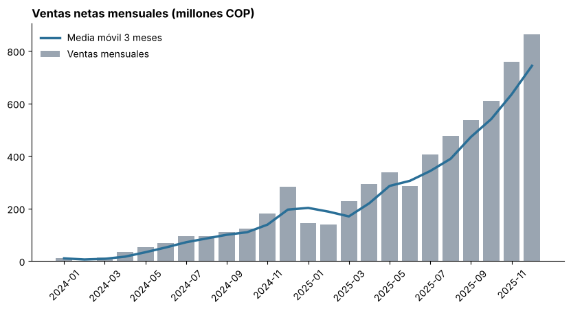
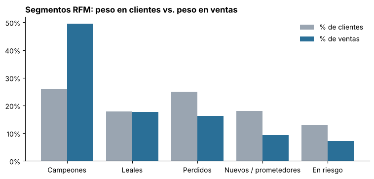

# 🛋️ Análisis de Ventas E-commerce · SQL + Python

> **EN:** End-to-end sales analysis for an online furniture store: relational model in SQLite, business queries with CTEs and window functions, EDA with pandas and RFM customer segmentation.

## Problema de negocio
Una tienda online de mobiliario quiere saber **qué categorías, canales y clientes impulsan sus ventas** y dónde enfocar inventario y marketing para 2026.

## Herramientas
`SQL (SQLite)` · `Python` · `pandas` · `matplotlib` · `Jupyter` · `Git`

## Lo que hice
1. **Modelé** una base relacional de 4 tablas (clientes, productos, pedidos, detalle) con llaves e índices → [`sql/01_schema.sql`](sql/01_schema.sql)
2. **Validé la calidad** de los datos: integridad referencial, duplicados y valores inválidos.
3. **Escribí 7 consultas de negocio** con `JOIN`, `CTE`, `LAG`, `RANK`, `SUM() OVER` y `CASE` → [`sql/02_consultas_negocio.sql`](sql/02_consultas_negocio.sql)
4. **Analicé** tendencia, estacionalidad, Pareto de categorías, canales y métodos de pago en Python.
5. **Segmenté clientes con RFM** (Recencia, Frecuencia, Valor) y exporté los segmentos para campañas.

📓 Notebook completo: [`notebooks/analisis_ventas.ipynb`](notebooks/analisis_ventas.ipynb)

## Hallazgos clave
| # | Hallazgo | Recomendación |
|---|---|---|
| 1 | Nov + Dic concentran el **31,9%** de las ventas anuales | Planear inventario y campañas desde octubre |
| 2 | Sala, Alcoba y Comedor = **84%** de los ingresos | Priorizar stock y pauta en estas categorías |
| 3 | Clientes **referidos** valen ~**20% más** que los de redes sociales | Lanzar programa de referidos |
| 4 | **Contraentrega** tiene la mayor cancelación (**8,3%**) | Incentivar pago anticipado |
| 5 | Los *Campeones* (26% de clientes) generan el **49,6%** de las ventas | Programa de fidelización + reactivar segmento *En riesgo* |




## Estructura
```
├── data/
│   ├── raw/               # CSV generados
│   ├── processed/         # segmentos_rfm.csv
│   └── ecommerce.db       # base SQLite
├── img/                   # gráficos del análisis
├── notebooks/analisis_ventas.ipynb
├── sql/                   # esquema y consultas de negocio
└── src/generar_datos.py   # genera datos y carga la base
```

## Cómo ejecutarlo
```bash
python -m venv .venv
.venv\Scripts\activate          # Windows  (macOS/Linux: source .venv/bin/activate)
pip install -r requirements.txt
python src/generar_datos.py      # crea data/ecommerce.db
jupyter notebook notebooks/analisis_ventas.ipynb
```

> ℹ️ Los datos son **sintéticos**, generados con semilla fija para que el análisis sea reproducible y no exponga información real de clientes.

---
**Juan Camilo Castro López** · Analista de Datos Jr · [LinkedIn](https://www.linkedin.com/in/juancastrolopez/) · [Portafolio](https://portafolio-juan-castro.vercel.app/)
